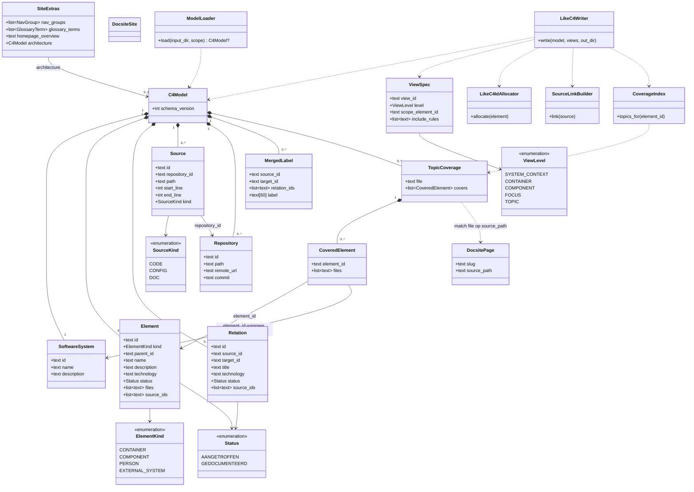
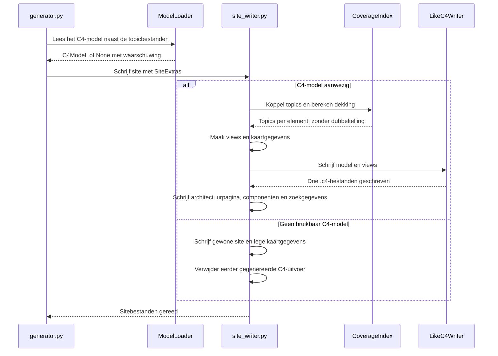

# Model: AutoDoc C4-kaart

Spec: [AutoDoc C4-kaart](../specs/2026-10-29-autodoc-c4-map-design.md) · Dossier: zonder dossier

## 1. Domeinmodel

<!-- handgeschreven, zonder dossier -->

Bron: [besluitenlog](../decisions/2026-10-27-autodoc-c4-map.md), domeinmodelpoort rij 32 en aanvullingen rij 33–45 en 52. De regelnummers hieronder zijn lokale verwijzingen, geen dossier-id's. Het model beschrijft zowel verplichtingen van de producent `map` als die van de consument AutoDoc; de structuuranalyse zelf valt buiten deze specificatie.

### Begrippen en verbanden

| Begrip             | Betekenis en verbanden                                                                                                                                                 |
| ------------------ | ---------------------------------------------------------------------------------------------------------------------------------------------------------------------- |
| Softwaresysteem    | Precies één systeem per `map`-run; bevat containers. De geïndexeerde root en scope bepalen de grens.                                                                   |
| Container          | Applicatie of datastore binnen het systeem; bevat componenten en kan ook rechtstreeks implementatiebestanden hebben. Geen synoniem voor directory of Docker-container. |
| Component          | Onderdeel binnen één container; wordt door implementatiebestanden of expliciete documentatie onderbouwd. Diepste getekende niveau.                                     |
| Persoon            | Onderbouwde actor/rol buiten het systeem die aan relaties kan deelnemen.                                                                                               |
| Extern systeem     | Onderbouwd softwaresysteem buiten de geïndexeerde systeemgrens.                                                                                                        |
| Relatie            | Gerichte afhankelijkheid of gegevensstroom tussen elementen, met titel, eventuele technologie, status en bronnen.                                                      |
| Bron               | Code, configuratie of expliciete projectdocumentatie met repository, bestand en regelbereik. Onderbouwt een element of relatie.                                        |
| Status             | `aangetroffen` wanneer minstens één bron code/configuratie is; anders `gedocumenteerd`. Geen derde, gemengde status.                                                   |
| Samengevoegde pijl | Projectie van alle onderliggende relaties tussen twee getoonde elementen. Geen nieuwe domeinrelatie of eigen status/bron.                                              |
| Topic              | Gegenereerde documentatiepagina. Dekt elementen via overlap van geciteerde en toegewezen implementatiebestanden.                                                       |
| View               | Projectie van het model op een C4-niveau of een afgesproken focus; bepaalt presentatie, niet architectuuridentiteit.                                                   |

### Regels met voorbeelden

| Regel                              | Invariant en verwacht voorbeeldresultaat                                                                                                                                                                                                                                                                                                                                              | Verantwoordelijkheid / besluit                                                                    |
| ---------------------------------- | ------------------------------------------------------------------------------------------------------------------------------------------------------------------------------------------------------------------------------------------------------------------------------------------------------------------------------------------------------------------------------------- | ------------------------------------------------------------------------------------------------- |
| R1 · Niveaus                       | Systeem → container → component; personen en externe systemen staan buiten het eigen systeem. Bestanden/klassen zijn bron, geen vierde kaartniveau. Voorbeeld: `VoyageAIProvider` krijgt geen eigen klassendiagram.                                                                                                                                                                   | `map` levert de hiërarchie; AutoDoc projecteert. Rij 11, 24.                                      |
| R2 · Onderbouwing en status        | Personen, externe systemen, interne onderdelen en relaties hebben minstens één bron. Code/configuratie wint voor de status; documentatie blijft als bron bewaard. Voorbeeld: Embedding met Python-code plus README is `aangetroffen`; een Beheerder zonder bron wordt niet opgenomen.                                                                                                 | `map` bepaalt bronnen en status. AutoDoc toont ze zonder nieuwe gevolgtrekkingen. Rij 14, 21, 29. |
| R3 · Alleen gedocumenteerd         | Interne onderdelen zonder implementatiebestand mogen bestaan met documentatiebron en zichtbare status `gedocumenteerd`; ze hebben geen directe topicdekking. Voorbeeld: Webdashboard uit alleen de README verschijnt zonder topics.                                                                                                                                                   | `map` levert de status; AutoDoc onderscheidt de presentatie. Rij 25, 40.                          |
| R4 · Bestandstoewijzing            | Een bestand hoort bij hoogstens één component. Gedeelde code kan rechtstreeks bij een container horen; geen automatische Helpers-component. Voorbeeld: `core/types/common.py` geeft op zichzelf geen dekking aan de componenten die het gebruiken.                                                                                                                                    | `map` maakt de toewijzing. Rij 13.                                                                |
| R5 · Topicdekking                  | Minstens één uniek gedeeld geciteerd bestand geeft dekking. Oprollen component → container → systeem gebruikt de unie van bestanden en dedupliceert topics. Gewicht ordent uitsluitend topiclinks. Voorbeeld: twee componenten met samen zeven unieke gedeelde bestanden geven hun container één topiclink met gewicht zeven.                                                         | `map` levert directe `covers` met bestanden; AutoDoc rolt op. Rij 12, 41.                         |
| R6 · Betekenis pijlen              | Een architectuurrelatie is gericht en onderbouwd; topiclinks zijn geen C4-relaties. Een README die betalingen naar Stripe expliciet beschrijft mag een relatie onderbouwen, maar maakt die niet `aangetroffen`.                                                                                                                                                                       | `map` onderzoekt relaties; AutoDoc verzorgt documentatienavigatie. Rij 11, 14–15.                 |
| R7 · Samenvoegen                   | Een uitgezoomde pijl bewaart alle onderliggende relaties, ook rechtstreekse; hun details tonen elk hun eigen bronnen en status, gesplitst in direct en afgeleid. Geen samengevatte status. Voorbeeld: Embedding→VoyageAI en een gedocumenteerde Reranking→VoyageAI blijven afzonderlijk inspecteerbaar.                                                                               | Native LikeC4-projectie plus aangepaste detailweergave. Rij 22, 28.                               |
| R8 · Pijllabel                     | Een pijl met één verschillende onderliggende titel neemt die over. Bij minstens twee verschillende titels levert `map` een korte abstractie, maximaal 60 tekens, uitsluitend uit die titels; een directe relatie krijgt geen voorrang. Geen `[...]`. Voorbeeld: embedding- en reranking-relaties kunnen het label “gebruikt voor embeddings en reranking” krijgen.                    | `map` maakt/controleert de samenvatting; AutoDoc past view-overrides toe. Rij 23, 28, 41.         |
| R9 · Labelkosten en terugval       | Alleen benodigde samenvattingen, gebundeld aangevraagd en hergebruikt zolang relatie-id's en titels gelijk blijven. Bij mislukken: twee titels met `·`; bij minstens drie de eerste titel met `+N relaties`, binnen dezelfde labelgrens.                                                                                                                                              | Producentverplichting van `map`; AutoDoc heeft geen LLM-aanroepen voor de kaart. Rij 27–28, 41.   |
| R10 · Identiteit                   | Neutrale identiteit berust op deterministische manifest-, dependency-, configuratie- of bestandsgegevens, niet op modelnamen, positie of LikeC4-FQN. Voorbeeld: hernoemen van Embedding naar Embedding-providers verandert de neutrale id niet bij dezelfde implementatie.                                                                                                            | `map` levert de id; AutoDoc bewaart hem in metadata en vertaalt alleen de presentatie-id. Rij 26. |
| R11 · Systeemgrens en repositories | Eén geïndexeerde root/scope kan meerdere geneste repositories bevatten; elke bron houdt zijn eigen repository/commit. Repositories buiten de index zijn alleen met onderbouwing extern. Geen federatie of configuratielijst van externe bronrepositories. Voorbeeld: samen geïndexeerde frontend/backend/infra horen bij één systeem; alleen backend indexeren maakt frontend extern. | `map` legt scope en repositorygegevens vast; AutoDoc bouwt commitvaste bronlinks. Rij 31, 34.     |

Weergaveregel (rij 52): “Hoort bij” en de doelen van een topicview gebruiken alleen directe dekking; opgerolde dekking blijft voor topiclinks bij bovenliggende elementen beschikbaar. Voorbeeld: directe dekking van Embedding voegt zijn container en systeem niet als topicdoelen toe. Dekt het topic ook rechtstreeks een container, dan blijven die container en Embedding beide doelen. Directe buren en eventuele bovenliggende kaders zijn kaartcontext, geen extra topicdoelen; zonder directe dekking ontbreken de regel en minikaart.

### Open issues

- **O-DOSSIER · zonder dossier.** Het domeinmodel en de voorbeelden zijn handgeschreven; geen dossiercontrole of I3-checkpoint.
- **O-MAP · Producent buiten deze scope.** Structuuranalyse, classificatie van bronsoorten, identiteit bij gewijzigde componentbestanden en identiteit van alleen gedocumenteerde onderdelen worden in `map-structuur-design` uitgewerkt. AutoDoc consumeert de afgesproken ids, status en volledige brongegevens. Die sessie is niet automatisch gesynchroniseerd met latere contractbesluiten; afstemming blijft een afhankelijkheid, geen uitgevoerde overdracht.

## 2. Ontwerpklassendiagram

Dataclasses en enums zijn het ontwerp, nog geen bestaande implementatie. Bestaande `DocsitePage` en `DocsiteSite` staan in `chunkhound/autodoc/models.py:31-50`. De weergave gebruikt Engelse namen; vrije tekst heeft geen vastgestelde lengtegrens, behalve het goedgekeurde label van 60 tekens.

`Element.description`, `Element.parent_id`, `Repository.remote_url`, `ViewSpec.scope_element_id`, `DocsitePage.source_path` en de optionele velden van `SiteExtras` kunnen ontbreken/leeg zijn volgens het contract of hun bestaande Python-type. `SoftwareSystem` is apart van `ElementKind`: het exportdocument heeft precies één `system`. De systeem-id mag wel endpoint of dekkingsdoel zijn. Hiërarchie en endpointverwijzingen gebruiken neutrale ids; geen LikeC4-FQN in het contract.

### Plaatsing en grenzen

| Module / bestaand bestand                  | Onderdelen en verantwoordelijkheid                                                                                                               |
| ------------------------------------------ | ------------------------------------------------------------------------------------------------------------------------------------------------ |
| `chunkhound/autodoc/architecture/model.py` | Contractdataclasses en enums, gegroepeerd rond `C4Model`. Geen database.                                                                         |
| `architecture/loader.py`                   | `ModelLoader`: model bij de gekozen input/scope vinden, lezen en controleren. Verwachte invoerproblemen via bestaande waarschuwingroute.         |
| `architecture/coverage.py`                 | `CoverageIndex`: unies van gedeelde bestanden per topic/element; oprollen zonder dubbeltelling.                                                  |
| `architecture/likec4_ids.py`               | `LikeC4IdAllocator`: neutrale ids naar geldige LikeC4-identifiers vertalen.                                                                      |
| `architecture/source_links.py`             | `SourceLinkBuilder`: repository/commit/range naar ondersteunde codehostlinks of tekst.                                                           |
| `architecture/views.py`                    | `ViewSpec` en afleiden van de afgesproken volledige, focus- en topicviews.                                                                       |
| `architecture/likec4_writer.py`            | `LikeC4Writer`: specificatie, model en views als DSL schrijven; teksten escapen.                                                                 |
| `architecture/site_data.py`                | Kaartgegevens voor definitieve topic-URL's, directe topicdoelen, view-id's en elementzoekrecords.                                                |
| `chunkhound/autodoc/models.py`             | `SiteExtras`; bestaande `DocsiteSite` blijft sitemetadata.                                                                                       |
| `chunkhound/autodoc/generator.py`          | Model laden na topics, bundel maken en bestaande generatie aanroepen.                                                                            |
| `chunkhound/autodoc/site_writer.py`        | Gewone site plus optionele kaart publiceren; volledige generatie versus `--assets-only` onderscheiden.                                           |
| Gegenereerde Astro/React-assets            | Kaart en minikaart weergeven met de fork; geen modelinferentie.                                                                                  |
| LikeC4-fork                                | `ElementDetailsCard.tsx` en `RelationshipPopover.tsx`: gestructureerde ChunkHound-metadata, bronnen, topics en status per onderliggende relatie. |

De optionele Astro-assets zijn `ArchitectureMap.astro` en `ArchitectureMiniMap.astro`: wrappers die hun React-kind rechtstreeks importeren en `client:only="react"` toepassen. `DocLayout.astro` ontdekt de wrappers, niet dynamisch te hydrateren React-tags. Zo blijft de kaart interactief en zijn zonder model geen LikeC4-virtuele imports nodig. De plugin gebruikt `throwIfInvalid: true` om eigen ongeldige DSL-generatie niet stil te accepteren. Bron: besluitenlog rij 46, [Astro client-directives](https://docs.astro.build/en/reference/directives-reference/#client-directives) en [LikeC4 v1.60.0 Vite-plugin-documentatie](https://github.com/likec4/likec4/blob/v1.60.0/apps/docs/src/content/docs/tooling/vite-plugin.mdx).

De LikeC4-fork wordt als gebouwd `.tgz`-pakket met ChunkHound gedistribueerd. AutoDoc kopieert het naar de gegenereerde site; `package.json` verwijst ernaar als lokale `file:`-dependency met pakketnaam `likec4`. De forkbuild verwerkt de aangepaste diagramcomponenten via de React-bundel in het uiteindelijke `likec4`-pakket. Forkupdates vervangen het archief; de uitvoering legt bronrevisie en licentievermeldingen vast. Geen eigen npm-publicatie en geen bewering dat overige npm-dependencies offline beschikbaar zijn. Bron: besluitenlog rij 47 en [LikeC4 v1.60.0 packagebuild](https://github.com/likec4/likec4/blob/v1.60.0/packages/likec4/tsdown.config.mts).

Bestandslijsten (`Element.files`, `CoveredElement.files`) en `Source.path` gebruiken dezelfde padruimte: POSIX-paden relatief aan de gezamenlijke indexroot. `Repository.path` ligt in die padruimte; alleen voor de codehost-URL wordt het repositoryvoorvoegsel van het bronpad verwijderd. `TopicCoverage.file` is daarentegen een topicbestandsnaam relatief aan de map-uitvoermap, gekoppeld aan de bestaande `DocsitePage.source_path`. Bron: besluitenlog rij 48, `chunkhound/code_mapper/scope.py:63-66` en `chunkhound/autodoc/index_loader.py:84-85`.

## 3. Vertaaltabel

Geen nieuwe tabellen of kolommen. De kolom bestaande opslag noemt alleen bestaande Python-velden wanneer die relevant zijn. `text` zonder grens betekent **lengte niet vastgesteld**; dit is geen nieuwe limiet. JSON-veldnamen blijven die van het goedgekeurde contract; bijvoorbeeld `sources` wordt intern `source_ids`, `parent` wordt `parent_id` en `relations` in een label wordt `relation_ids`.

| Concept / fact type                    | Design element                                           | Kind            | Type and size                                   | Existing table/column                                 | Note                                                                                                  |
| -------------------------------------- | -------------------------------------------------------- | --------------- | ----------------------------------------------- | ----------------------------------------------------- | ----------------------------------------------------------------------------------------------------- |
| Softwaresysteem                        | `SoftwareSystem`                                         | class           | —                                               | —                                                     | Eén `C4Model.system`, R1/R11.                                                                         |
| Container                              | `Element`, `kind=CONTAINER`                              | class           | —                                               | —                                                     | Ouder is het systeem, R1.                                                                             |
| Component                              | `Element`, `kind=COMPONENT`                              | class           | —                                               | —                                                     | Ouder is een container, R1/R4.                                                                        |
| Persoon                                | `Element`, `kind=PERSON`                                 | class           | —                                               | —                                                     | Alleen met bron, R2.                                                                                  |
| Extern systeem                         | `Element`, `kind=EXTERNAL_SYSTEM`                        | class           | —                                               | —                                                     | Buiten systeemgrens, R2/R11.                                                                          |
| Elementnaam/-beschrijving/-technologie | `Element.name/description/technology`                    | attribute       | text; lengte niet vastgesteld                   | —                                                     | Beschrijving is optioneel, besluit rij 41.                                                            |
| Neutrale identiteit                    | `SoftwareSystem.id`, `Element.id`, `Relation.id`         | attribute       | text; lengte niet vastgesteld                   | —                                                     | Door `map` aangeleverd, R10.                                                                          |
| Bevat container/component              | `Element.parent_id`                                      | relation        | text; lengte niet vastgesteld                   | —                                                     | Neutrale id; geen directory-afleiding door AutoDoc.                                                   |
| Implementatiebestand                   | `Element.files`                                          | attribute       | lijst van tekstpaden; lengte niet vastgesteld   | —                                                     | R3/R4; geen apart code-element.                                                                       |
| Relatie                                | `Relation`                                               | class           | —                                               | —                                                     | Gericht; endpoints verwijzen naar systeem of element, R6.                                             |
| Relatietitel/-technologie              | `Relation.title/technology`                              | attribute       | text; lengte niet vastgesteld                   | —                                                     | Geen nieuwe vrije inferentie in AutoDoc.                                                              |
| Bron                                   | `Source`                                                 | class           | —                                               | —                                                     | Bestand/range en bronsoort, R2.                                                                       |
| Onderbouwt                             | `Element.source_ids`, `Relation.source_ids`              | relation        | lijst van tekst-id's; lengte niet vastgesteld   | —                                                     | Bronnen niet tot een samengevatte provenance platmaken.                                               |
| Bronsoort                              | `SourceKind`                                             | enum            | CODE / CONFIG / DOC                             | —                                                     | JSON `code` / `config` / `doc`; producent classificeert.                                              |
| Repository van bron                    | `Repository`, `Source.repository_id`                     | relation        | text; lengte niet vastgesteld                   | —                                                     | Technische provenance, remote mag ontbreken, R11.                                                     |
| Regelbereik                            | `Source.start_line/end_line`                             | attribute       | integer; geen veldbreedte vastgesteld           | —                                                     | Codehost ontvangt volledige bronfile plus anker, niet een codefragment.                               |
| Status                                 | `Status`                                                 | enum            | AANGETROFFEN / GEDOCUMENTEERD                   | —                                                     | JSON `aangetroffen` / `gedocumenteerd`, R2.                                                           |
| Status uit bronnen                     | Door `map` bepaalde `Element.status` / `Relation.status` | derived         | Status                                          | —                                                     | R2; consument leidt geen nieuwe architectuur af.                                                      |
| Samengevoegde pijl                     | LikeC4-relatieprojectie                                  | not in software | —                                               | —                                                     | Niet opgeslagen als nieuwe relatie; LikeC4 projecteert alle onderliggende relaties, R7.               |
| Samenvattend pijllabel                 | `MergedLabel.label`                                      | attribute       | text[60]                                        | —                                                     | Door `map` aangeleverd, alleen presentatie, R8/R9.                                                    |
| Onderliggende relaties van label       | `MergedLabel.relation_ids`                               | relation        | lijst van tekst-id's; lengte niet vastgesteld   | —                                                     | Geen voorrang voor directe relatie, R7/R8.                                                            |
| Topic                                  | `TopicCoverage` plus `DocsitePage`                       | class           | —                                               | `DocsitePage.source_path`, `slug` (`models.py:32-38`) | Bestand koppelt producenttopic aan definitieve URL.                                                   |
| Directe topicdekking                   | `CoveredElement`                                         | relation        | element-id plus unieke gedeelde bestanden       | —                                                     | R5; bepaalt “Hoort bij” en topicviewdoelen (rij 52); geen gewicht zonder controleerbare bestanden.    |
| Opgerolde dekking/gewicht              | `CoverageIndex`                                          | derived         | unie van bestandspaden; aantal unieke bestanden | —                                                     | R5; topiclinks bij ouders en sortering, geen extra topicviewdoelen, pijlen of versterking van bewijs. |
| View                                   | `ViewSpec`                                               | derived         | view-id, niveau, scope en include-regels        | —                                                     | Projectie van bestaande elementen; niet onderdeel van neutrale JSON.                    |
| Optionele site-inhoud                  | `SiteExtras`                                             | class           | —                                               | —                                                     | Technische parameterbundel, geen domeinbegrip of tweede site.                           |
| Sitemetadata                           | `DocsiteSite`                                            | class           | bestaande velden                                | `models.py:44-50`                                     | Blijft ongewijzigd.                                                                     |

## 4. Design patterns

| Pattern                    | Source                                                                         | Force                                                                                                                                                                | Roles                                                                                       | Rejected alternative                                                                                                                                                                                                        |
| -------------------------- | ------------------------------------------------------------------------------ | -------------------------------------------------------------------------------------------------------------------------------------------------------------------- | ------------------------------------------------------------------------------------------- | --------------------------------------------------------------------------------------------------------------------------------------------------------------------------------------------------------------------------- |
| Introduce Parameter Object | [Martin Fowler](https://refactoring.com/catalog/introduceParameterObject.html) | De siteschrijver heeft al losse optionele navigatie-, woordenlijst- en homepageparameters. Architectuur toevoegen zonder die parameterlijst verder te laten groeien. | Producent → `generator.py`; parameterobject → `SiteExtras`; consument → `write_astro_site`. | `DocsiteSite` verbreden tot het volledige sitemodel volgens [Preserve Whole Object](https://refactoring.com/catalog/preserveWholeObject.html): grotere herstructurering, niet nodig voor deze kaart. Goedgekeurd in rij 43. |

Geen aanvullende Strategy-, Factory- of servicelaag: daarvoor is geen aparte force of goedgekeurde keuze.

## 5. Sequencediagrammen

### Volledige generatie

Goedgekeurd in besluitenlog rij 44. Model lezen gebeurt na het laden van de topics; definitieve topic-URL's komen uit de gemaakte `DocsitePage`-objecten. De eventuele bestaande LLM-topicopschoning blijft buiten de kaartvertaling.

Daarna, in een afzonderlijke Astro-build: de LikeC4-plugin leest de DSL, berekent views/lay-out en levert de virtuele React-module. De browser rendert het gebouwde model; geen nieuwe architectuuranalyse of LLM-aanroep.

### Presentatie-update

`write_astro_assets_only` vernieuwt UI-componenten en configuratie. Bestaande topicinhoud, `.c4`-bestanden en `architecture.json` blijven behouden. Geen herladen van het producentmodel en geen herberekening van dekking. Een oudere site zonder `architecture.json` krijgt lege kaartgegevens. Alleen volledige generatie verwijdert verouderde, door AutoDoc gemaakte C4-uitvoer; andere bestanden blijven ongemoeid.
