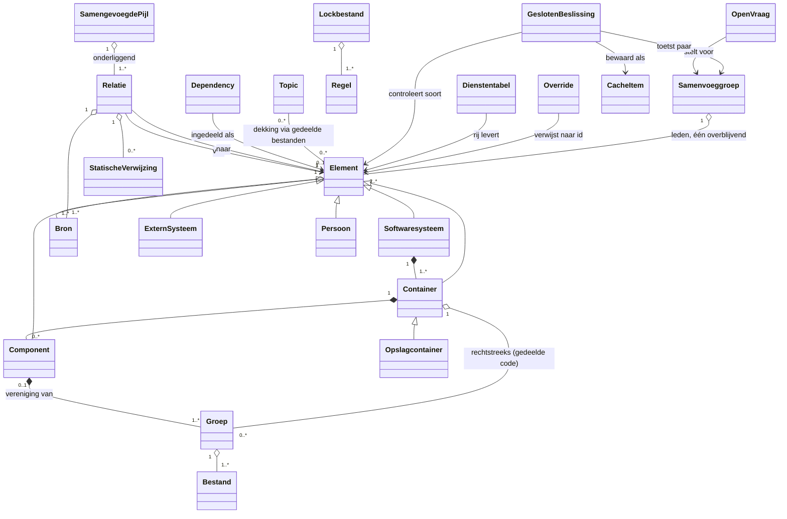
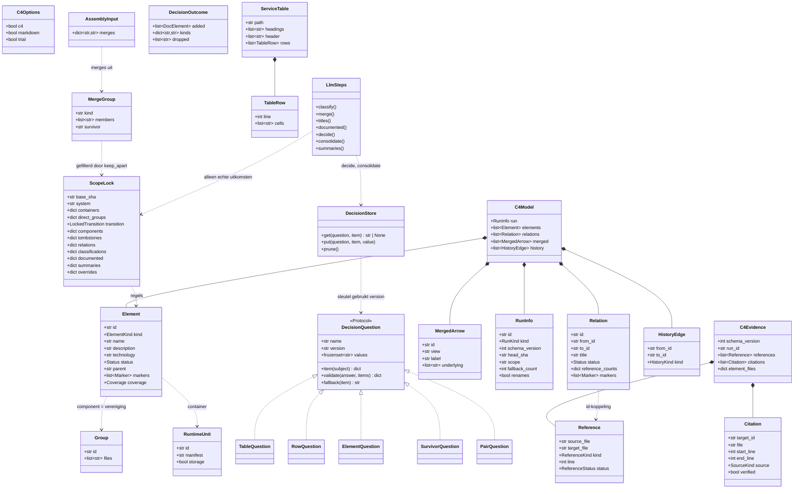

# Model: map-structuuranalyse

Spec: [2026-10-27-map-structuuranalyse-design.md](../specs/2026-10-27-map-structuuranalyse-design.md) · Vervolg: [O-MAP LLM-beslissingen](../specs/2026-11-06-omap-llm-beslissingen-design.md) (R17-R23) · Dossier: geen (zonder dossier, besluitenlog rij 13)

## 1. Domeinmodel

<!-- handgeschreven, zonder dossier -->

Bindend kader: het domeinmodel van de AutoDoc-C4-sessie (`autodoc-c4-design/docs/melly/decisions/2026-10-27-autodoc-c4-map.md`, hierna "C4-log", rij 11–32). Dit hoofdstuk voegt de begrippen en regels toe die `map` nodig heeft om de structuur te leveren. Rijnummers zonder voorvoegsel verwijzen naar `docs/melly/decisions/2026-10-27-map-structuuranalyse.md`.



### Begrippen

| Begrip                   | Betekenis                                                                                                                                                                                                                                                                    | Bron                                          |
| ------------------------ | ---------------------------------------------------------------------------------------------------------------------------------------------------------------------------------------------------------------------------------------------------------------------------- | --------------------------------------------- |
| Softwaresysteem          | Precies één per `map`-run; alles binnen root en scope                                                                                                                                                                                                                        | C4-log rij 31                                 |
| Container                | Deployable met een manifest dat startpunten, binary, siteframework of Dockerfile declareert; bibliotheken horen bij de laadende container                                                                                                                                    | rij 5                                         |
| Opslagcontainer          | Gedeclareerde opslaglocatie (configsleutel, DSN, volume), identiteit = configsleutel                                                                                                                                                                                         | rij 6                                         |
| Groep                    | Bouwsteen: de bestanden van één map binnen een container, afgeleid uit de paden, herspeelbaar                                                                                                                                                                                | rij 2; O-MAP §4.1                             |
| Component                | Vereniging van ≥1 groep binnen één container                                                                                                                                                                                                                                 | rij 2                                         |
| Extern systeem / Persoon | Element buiten het systeem, alleen met ≥1 bron; een persoon is een menselijke rol of een AI-agentrol (R17)                                                                                                                                                                   | C4-log rij 21; besluit Domeinmodel · personen |
| Dependency               | Pakket met ≥1 runtime-import of configuratieverwijzing; ingedeeld als bibliotheek, extern systeem of opslagdriver                                                                                                                                                            | rij 9, 12                                     |
| Statische verwijzing     | `(van, naar, soort, regel, status)`; soort import / aanroep / overerving; status telt / alleen type / ongebruikt                                                                                                                                                             | rij 7, 11, 32                                 |
| Relatie                  | Gericht verband tussen twee elementen, één per geordend paar                                                                                                                                                                                                                 | rij 1, 35                                     |
| Samengevoegde pijl       | Pijl in een view die onderliggende relaties bundelt                                                                                                                                                                                                                          | C4-log rij 22, 23                             |
| Bron                     | Code, configuratie of documentatie met bestand:regel                                                                                                                                                                                                                         | C4-log rij 29                                 |
| Status                   | _aangetroffen_ of _gedocumenteerd_                                                                                                                                                                                                                                           | C4-log rij 29                                 |
| Topic / Dekking          | HyDE-topic; dekking via gedeelde geciteerde bestanden                                                                                                                                                                                                                        | rij 23; C4-log rij 12                         |
| Lockbestand / Regel      | Opgeslagen indeling, identiteit, soorten, titels, correcties                                                                                                                                                                                                                 | rij 18, 26, 31                                |
| Override                 | Handgeschreven regel in `overrides` van het lockbestand; `drop` (lijst van element-ids) haalt een extern systeem of persoon weg, `merge` (bron-id → doel-id) voegt het samen met een doel van dezelfde soort, `keep_apart` (paren element-ids) verbiedt een LLM-samenvoeging | O-MAP §20; LLM-beslissingen §7                |
| Documentterm             | `person` of `external` uit de documentstap, met een geverifieerd citaat waarin de term als heel woord staat                                                                                                                                                                  | rij 154; O-MAP §19.3                          |
| Open vraag               | Generatieve LLM-vraag die kandidaten voorstelt (documentstap, samenvoegvoorstel)                                                                                                                                                                                             | besluit Domeinmodel · open en gesloten vragen |
| Gesloten beslissing      | LLM-vraag met vaste keuzeset en criteria per optie; het model krijgt alleen wat de beslissing nodig heeft                                                                                                                                                                    | idem                                          |
| Samenvoeggroep           | Elementen van dezelfde soort die dezelfde actor of hetzelfde systeem zijn; precies één overblijvend lid                                                                                                                                                                      | R18, R19a                                     |
| Dienstentabel            | Markdown-tabel in de documentatie die externe diensten opsomt                                                                                                                                                                                                                | R21                                           |
| Cache-item               | Eén opgeslagen gesloten beslissing of samenvoegvoorstel; sleutel = invoer, vraagversie, provider, model en effort                                                                                                                                                            | R23                                           |
| Run                      | _volledig_ of _proef_ (`--plan`)                                                                                                                                                                                                                                             | rij 28                                        |

### Regels met voorbeeld

| #    | Regel                                                                                                                                                                                                                                                                | Voorbeeld → verwachte uitkomst                                                                                                                                                                                                                  |
| ---- | -------------------------------------------------------------------------------------------------------------------------------------------------------------------------------------------------------------------------------------------------------------------- | ----------------------------------------------------------------------------------------------------------------------------------------------------------------------------------------------------------------------------------------------- |
| R1   | Een relatie tussen twee _aangetroffen_ interne elementen staat alleen op de kaart met ≥1 statische verwijzing met status _telt_; een citaat zonder zo'n verwijzing is "niet geverifieerd" in het bewijs                                                              | `service.py:28` import → pijl Code Mapper → Deep Research (geldig); "Code Mapper voedt AutoDoc" alleen als citaat → niet op de kaart (rij 1)                                                                                                    |
| R2   | Een component is een vereniging van hele groepen; elk bestand hoort bij ≤1 component; een groep mag rechtstreeks onder de container blijven, zonder automatische verzamelcomponent                                                                                   | G1+G2 → "Code Mapper"; `render.py` los uit G2 halen → ongeldig (rij 2); `core/types/common.py` rechtstreeks onder de container → geldig, geen "Helpers" (C4-log rij 13; rij 38)                                                                 |
| R3   | B erft het id van A iff 2·∣A∩B∣ > ∣A∣ en 2·∣A∩B∣ > ∣B∣, over bestanden in beide runs, git-renames gelijk; anders nieuw, nooit hergebruikt id                                                                                                                         | (a) 8/10 + 2 nieuw → erft; (b) 5 + 5 → beide nieuw; (b′) 6 + 4 → de 6 erft (rij 3, 10)                                                                                                                                                          |
| R4   | Id = soort + genormaliseerde letterlijke term; een _gedocumenteerd_ element houdt zijn id als het _aangetroffen_ wordt                                                                                                                                               | "Ontwikkelaar met AI-assistent" (`README.md:60`) → `persoon:ontwikkelaar-met-ai-assistent` (rij 4)                                                                                                                                              |
| R5   | Containers volgen runtime-grenzen; sjablonen tellen niet                                                                                                                                                                                                             | `pyproject.toml` → `container:chunkhound`; `chunkhound/autodoc/assets/package.json` (`{{PACKAGE_NAME}}`) → geen container (rij 5)                                                                                                               |
| R6   | Een nieuwe dependency krijgt haar soort uit 3 stemmen: 3–0 soort; 2–1 meerderheid + _omstreden_; 1–1–1 bibliotheek + gemarkeerd                                                                                                                                      | `pyarrow` → bibliotheek, _omstreden (1× opslagdriver)_ (rij 12)                                                                                                                                                                                 |
| R7   | Elke statische verwijzing en elk citaat staat onafgekapt in het bewijs; alleen `drop` en `merge` (R13, R14) en de LLM-stappen (R18, R20) halen citaten van weggehaalde elementen en relaties bewust weg, de verwijzingen blijven                                     | 12 imports + 9 citaten → 21 regels in het bewijs (rij 8)                                                                                                                                                                                        |
| R8   | Type-only en ongebruikte (niet-re-export) imports geven geen pijl                                                                                                                                                                                                    | `service.py:30-31` onder `TYPE_CHECKING` → geen pijl; `core/git_diff/__init__.py:1` re-export → telt (rij 7, 11)                                                                                                                                |
| R9   | Status _aangetroffen_ zodra ≥1 bron code of configuratie is, anders _gedocumenteerd_                                                                                                                                                                                 | Embedding met `voyageai_provider.py` + `README.md` → _aangetroffen_ (C4-log rij 29)                                                                                                                                                             |
| R10  | Een documentatiecitaat telt alleen als het letterlijk op het opgegeven bestand:regel staat                                                                                                                                                                           | Citaat "Webdashboard" dat niet op `README.md:60` staat → afgekeurd (rij 34)                                                                                                                                                                     |
| R11  | Handmatige `overrides` in het lockbestand gaan voor op elke afgeleide uitkomst                                                                                                                                                                                       | override `pyarrow = opslagdriver` → geen stemming, soort opslagdriver (rij 31)                                                                                                                                                                  |
| R12  | Terugval en proef worden nooit opgeslagen; alleen een proefrun maakt voorlopige componenten, een mislukte merge verzint er geen                                                                                                                                      | samenvoegstap twee keer time-out → eerder geplaatste componenten blijven, de overige groepen staan als wachtend in het rapport en worden de volgende run opnieuw aangeboden, `base_sha` blijft staan (rij 19, 30; O-MAP §4.5)                   |
| R13  | `drop` haalt een extern systeem of persoon weg uit kaartmodel, bewijs en contract, met alle relaties die het raakt; een codereferentie blijft in het bewijs zonder relatie                                                                                           | `"drop": ["external:httpx"]` → geen `external:httpx`, geen relatie `chunkhound -> httpx`; de run slaagt (O-MAP §20)                                                                                                                             |
| R14  | `merge` voegt een extern systeem of persoon samen met een doel van dezelfde soort; het doel houdt naam, omschrijving en id, citaten en relaties gaan mee, dubbele relaties vallen samen, de status volgt R9                                                          | `"merge": {"external:google": "external:gemini"}` → alleen `external:gemini`, _aangetroffen_ via `gemini_llm_provider.py:20` (O-MAP §20)                                                                                                        |
| R15  | De documentstap maakt (a) geen extern systeem van een categorie of rol zonder eigen naam, personen mogen een rol zijn; (b) geen element van een naam die alleen in een voorbeeld staat; (c) geen element van een bibliotheek, ook niet als de tekst zegt wat ze doet | "requires an embedding provider" → geen element; `chunkhound websearch "Stripe webhook retry schedule"` → geen `stripe`, maar "DuckDuckGo provides web search results" → `duckduckgo`; "per-phase `httpx` timeout" → geen `httpx` (O-MAP §20.3) |
| R16  | Een ongeldige `drop` of `merge` (onbekend id, andere soort, keten, samen met `drop`) wordt overgeslagen met een rapportregel; `drop` gaat voor `merge`; een fout in de structuur is een fout bij het laden van het lockbestand                                       | `"drop": ["container:chunkhound"]` → `C4-overrides: drop ignored for container:chunkhound (not an external system or person)`; bij `a -> b` en `b -> c` alleen `b -> c` (O-MAP §20.4)                                                           |
| R17  | Een persoon is een menselijke rol of een AI-agentrol die het systeem gebruikt                                                                                                                                                                                        | "gives agents and teams cited context" (`README.md:28`) → personen `agents` en `teams`                                                                                                                                                          |
| R18  | Een LLM-stap voegt personen en externe systemen samen, alleen binnen de eigen soort; niets daarvan komt in de lock                                                                                                                                                   | `agents` + `AI assistant` → één persoon; `google` + `google-gemini` → één extern systeem; persoon + extern systeem → ongeldig (R14, R16)                                                                                                        |
| R19  | Een open vraag stelt voor, een gesloten beslissing toetst, de code voert uit; alleen `same` voegt samen, `unsure` houdt apart                                                                                                                                        | groep {`agents`, `AI assistant`} → paarvraag `same` → samengevoegd; `unsure` → blijven apart                                                                                                                                                    |
| R19a | Het overblijvende element is een bestaand lid, gekozen met een gesloten keuze                                                                                                                                                                                        | {`google`, `google-gemini`} → `google-gemini`; een nieuwe naam "AI agent" → ongeldig                                                                                                                                                            |
| R20  | Elk element uit de documentstap krijgt de gesloten controle persoon / extern systeem / geen van beide, met de criteria uit R15 en R17                                                                                                                                | `astro` → geen van beide (R15c), valt weg; `https-endpoint` → geen van beide (R15a), valt weg; `AI assistant` → persoon                                                                                                                         |
| R21  | De code haalt de tabellen uit de documentatie; een gesloten tabelvraag beslist of het een dienstentabel is, en per rij daarvan beslist een gesloten rijvraag de soort                                                                                                | LLM-tabel `configuration.md:497-509` → dienstentabel; rij "OpenCode CLI" → extern systeem met relatie `uses`; vlaggentabel in `cli-reference.md` → geen dienstentabel                                                                           |
| R22  | Eerst de LLM-stappen, dan `drop`/`merge`/`names`; `keep_apart` verbiedt een samenvoeging; een override op een opgegaan id volgt het doel                                                                                                                             | `keep_apart: [["person:agents", "person:teams"]]` → apart, ook bij `same`; `names: {"person:agents": "AI agent"}` met `agents` opgegaan in `ai-assistant` → het doel heet "AI agent"                                                            |
| R23  | Elke gesloten beslissing en het samenvoegvoorstel staan per item in een cache; opnieuw beslissen alleen bij gewijzigde invoer                                                                                                                                        | run zonder wijziging → 0 aanroepen, dezelfde kaart; nieuwe tabelrij → die rij, het voorstel van die soort en de nieuwe paren (de tabelvraag alleen als de rij bij de eerste drie hoort); ander utility-model of -effort → alles                 |

Geschiedenis bij R3 (uitvoeringsbesluit R): behoud elk paar met ≥10% overlap aan één kant, over bestanden in beide runs na renames. Meerdere voorgangers → `merge`, anders meerdere opvolgers → `split`, anders `continuation`; het label bewijst geen overerving. Niet-geërfde nieuwe id's krijgen tevens `new` (`from_id=""`), niet-geërfde oude id's `removed` (`to_id=""`) plus tombstone `oud_id → oud_id`. Andere eindpunten zijn echte id's; bestaande tombstones blijven staan en beide kolommen reserveren id's.

R17-R23 (2026-11-06) herzien O-MAP §20.7 "Automatisch samenvoegen: bewust niet". R13-R16 blijven gelden en werken na de LLM-stappen (R22).

### Open issues

- **zonder dossier:** begrippen en regels zijn niet tegen een COGNiam-dossier gecontroleerd (rij 13).
- **R19a** is een afleiding uit R19, goedgekeurd met het domeinmodel (besluit Domeinmodel · poort).
- **Diensten in lopende tekst** blijven afhankelijk van de open documentstap.
- **Terughalen:** een element dat de controle (R20) onterecht als "geen van beide" weghaalt, is niet terug te halen (besluit Ontwerp · sectie 4).

## 2. Ontwerpklassendiagram



Groepen zijn een pure afleiding uit de paden (O-MAP §4.1), dus het lockbestand bewaart geen indeling meer: schemaversie 4 vervalt `tree_spec` en `group_membership`. Een lockbestand met een oudere versie wordt geweigerd met de melding het te verwijderen.

Taak 13, gebruiker **"optie 1"**: het lockbestand bewaart expliciete succesvolle `direct_groups` per container en optionele `transition` met `input_fingerprint`, `history` en `renames`. Een ongewijzigde uitvoering herhaalt de laatste succesvolle analysetransitie; zij maakt geen nieuwe geschiedenis. De vingerafdruk bevat werkelijke bestandsinhoud, HEAD, scope, configuratie, topics en overrides. Gewijzigde invoer berekent een nieuwe transitie; terugval/proef levert geen herbruikbare snapshot. Mislukte mergegroepen staan niet in `direct_groups`, zodat ze niet als succesvolle directe plaatsingen kunnen worden aangezien.

LLM-beslissingen (spec 2026-11-06): `c4_group` is een open vraag en implementeert `DecisionQuestion` niet; die vraag krijgt een eigen functie in `consolidation.py` met dezelfde `DecisionStore`. Bestanden: `code_mapper/c4/decisions.py` (`decide`), `code_mapper/c4/consolidation.py` (`consolidate`), `DecisionStore` in `services/extraction/store.py`, zes prompts `code_mapper/prompts/c4_{table,row,element,group,survivor,pair}.md`. Types komen uit de bestaande code, niet uit een dossier.

## 3. Vertaaltabel

| Begrip / feittype        | Ontwerpelement                                                                                                                                                                      | Soort           | Type en omvang                                                                                                | Bestaande tabel/kolom | Opmerking                                                                                                        |
| ------------------------ | ----------------------------------------------------------------------------------------------------------------------------------------------------------------------------------- | --------------- | ------------------------------------------------------------------------------------------------------------- | --------------------- | ---------------------------------------------------------------------------------------------------------------- |
| Softwaresysteem          | `Element` met `kind=system`                                                                                                                                                         | class           | —                                                                                                             | —                     | één per run                                                                                                      |
| Container                | `RuntimeUnit` → `Element` met `kind=container`                                                                                                                                      | class           | —                                                                                                             | —                     | `runtime.py`                                                                                                     |
| Opslagcontainer          | `RuntimeUnit.storage` → `Element` met `kind=storage`                                                                                                                                | attribute       | bool                                                                                                          | —                     |                                                                                                                  |
| Groep                    | `Group`                                                                                                                                                                             | class           | —                                                                                                             | —                     | `grouping.py`, één per map                                                                                       |
| Component                | `Element` met `kind=component`                                                                                                                                                      | class           | —                                                                                                             | —                     | `identity.py` (R3)                                                                                               |
| Extern systeem           | `Element` met `kind=external`                                                                                                                                                       | class           | —                                                                                                             | —                     |                                                                                                                  |
| Persoon                  | `Element` met `kind=person`                                                                                                                                                         | class           | —                                                                                                             | —                     | alleen uit `documented.py`                                                                                       |
| Dependency               | lockbestand `classifications`                                                                                                                                                       | attribute       | —                                                                                                             | —                     | geen eigen element; bibliotheek valt van de kaart                                                                |
| Statische verwijzing     | `Reference`                                                                                                                                                                         | class           | —                                                                                                             | —                     | `references.py`                                                                                                  |
| Relatie                  | `Relation`                                                                                                                                                                          | class           | —                                                                                                             | —                     | id `<van-id>-><naar-id>`                                                                                         |
| Samengevoegde pijl       | `MergedArrow`                                                                                                                                                                       | class           | —                                                                                                             | —                     | `summaries`                                                                                                      |
| Bron                     | `Citation`, `Reference`                                                                                                                                                             | class           | —                                                                                                             | —                     |                                                                                                                  |
| Status                   | `Status`                                                                                                                                                                            | enum            | `found` \| `documented`                                                                                       | —                     | R9                                                                                                               |
| Topic / Dekking          | `Element.coverage`                                                                                                                                                                  | attribute       | —                                                                                                             | —                     | `topic_coverage.py`                                                                                              |
| Lockbestand / Regel      | `ScopeLock`                                                                                                                                                                         | class           | —                                                                                                             | —                     | `.chunkhound/map.lock.json`                                                                                      |
| Override                 | `Overrides.drop`, `Overrides.merge`, `Overrides.keep_apart`; nabewerking in `curation.py` (pass 1 LLM, pass 2 lock), overgeslagen vermeldingen in `AssemblyNotes.ignored_overrides` | attribute       | `list[str]`, `dict[str, str]`, `list[tuple[str, str]]`                                                        | —                     | R13, R14, R16, R22                                                                                               |
| Run                      | `RunInfo`                                                                                                                                                                           | class           | —                                                                                                             | —                     | `kind` `full` \| `trial`; `id` = sha256 over model en bewijs zonder id, gedeeld met `C4Evidence.run_id` (rij 39) |
| Opgeheven id             | `ScopeLock.tombstones`                                                                                                                                                              | attribute       | —                                                                                                             | —                     | R3                                                                                                               |
| Markering                | `Marker`                                                                                                                                                                            | enum            | `fallback`, `trial`, `disputed`, `undescribed`, `imports_only`, `provisional`, `not_merged`, `not_classified` | —                     | rij 19, 35                                                                                                       |
| Open vraag               | `extract_documented`, `propose_groups` in `consolidation.py`                                                                                                                        | class / functie | —                                                                                                             | —                     | `c4_group` is nieuw                                                                                              |
| Gesloten beslissing      | `DecisionQuestion` met `TableQuestion`, `RowQuestion`, `ElementQuestion`, `SurvivorQuestion`, `PairQuestion`                                                                        | class           | —                                                                                                             | —                     | keuzeset in `values`                                                                                             |
| Dienstentabel            | `ServiceTable`                                                                                                                                                                      | class           | —                                                                                                             | —                     | R21                                                                                                              |
| Rij levert element       | `TableRow` → `DocElement` + `DocRelation` met titel `uses`                                                                                                                          | relation        | —                                                                                                             | —                     | term = zichtbare tekst van de eerste cel                                                                         |
| Samenvoeggroep           | `MergeGroup`                                                                                                                                                                        | class           | —                                                                                                             | —                     | R18, R19                                                                                                         |
| Overblijvend lid         | `MergeGroup.survivor`                                                                                                                                                               | attribute       | `str` (id)                                                                                                    | —                     | R19a                                                                                                             |
| Samenvoeging door de LLM | `AssemblyInput.merges`                                                                                                                                                              | attribute       | `dict[str, str]`                                                                                              | —                     | bron-id → doel-id                                                                                                |
| Cache-item               | bestand van `DecisionStore`                                                                                                                                                         | class           | JSON                                                                                                          | —                     | `.chunkhound/extraction/decisions/<vraag>/<sleutel>.json`, R23                                                   |
| Paaruitkomst             | `PairQuestion.values`                                                                                                                                                               | enum            | `same` \| `different` \| `unsure`                                                                             | —                     | alleen `same` voegt samen (R19)                                                                                  |

Omvang van tekstvelden: geen; JSON zonder grens, behalve het samenvattende label (≤60 tekens, rij 35).

## 4. Design patterns

| Patroon  | Bron                                                                                                                       | Kracht                                                                                                                          | Rollen                                                                                                                                                                                  | Afgewezen alternatief                                                                                                                          |
| -------- | -------------------------------------------------------------------------------------------------------------------------- | ------------------------------------------------------------------------------------------------------------------------------- | --------------------------------------------------------------------------------------------------------------------------------------------------------------------------------------- | ---------------------------------------------------------------------------------------------------------------------------------------------- |
| Strategy | Gamma et al., _Design Patterns_ (1994), Strategy, p. 315; in de repo `ExtractionGoal` (`services/extraction/runner.py:43`) | vijf gesloten vragen delen één levenscyclus: korte id's, schudden, cache, bundelen, aanroep, herkansing, fallback, wegschrijven | Strategy → `DecisionQuestion`; ConcreteStrategy → `TableQuestion`, `RowQuestion`, `ElementQuestion`, `SurvivorQuestion`, `PairQuestion`; Context → de gedeelde runner in `decisions.py` | één functie per vraag zoals `classify.py` (levenscyclus zes keer); een gegevenstabel per vraag (validatie per vraag past slecht in een record) |

Besluit: rij "Ontwerp · patroon en klassendiagram" (2026-11-06).

## 5. Sequencediagrammen

```mermaid
sequenceDiagram
  participant CLI as commands/code_mapper.py
  participant Topics as HyDE + deep research
  participant C4 as c4-tak
  participant LLM as LlmSteps
  participant Lock as lockfile.py
  participant W as writer (Markdown + c4/writer.py)
  CLI->>Lock: lees sectie scope
  par topics (tenzij --plan)
    CLI->>Topics: HyDE, deep research
  and C4 (tenzij --no-c4)
    CLI->>C4: references, runtime, grouping (replay)
    C4->>LLM: classify / merge / titles (alleen nieuw; niet bij --plan)
  end
  CLI->>LLM: documented (alle documenten in de scope; alleen bij gewijzigde hash of stapversie)
  CLI->>LLM: decide: c4_table, c4_row, c4_element (alleen items zonder cachetreffer; de lock houdt de onbewerkte documentuitkomst)
  CLI->>C4: _prepare, _identify, invoervingerafdruk, history/renames hergebruiken indien gelijk (pipeline.py:769-775)
  CLI->>C4: AssemblyInput
  CLI->>LLM: consolidate: c4_group per soort, keep_apart filteren, c4_survivor, c4_pair -> AssemblyInput.merges
  CLI->>C4: _titles, assemble: curate pass 1 (LLM), pass 2 (lock)
  CLI->>C4: topic_coverage, summaries
  C4->>LLM: summaries (alleen nieuwe labels)
  CLI->>W: Markdown, _c4_map_model.json + _c4_map_evidence.json (samen), daarna _c4_model.json (contract, alleen volledige run)
  CLI->>Lock: os.replace na volledige run met exitcode 0; terugvalitems weggelaten
```
