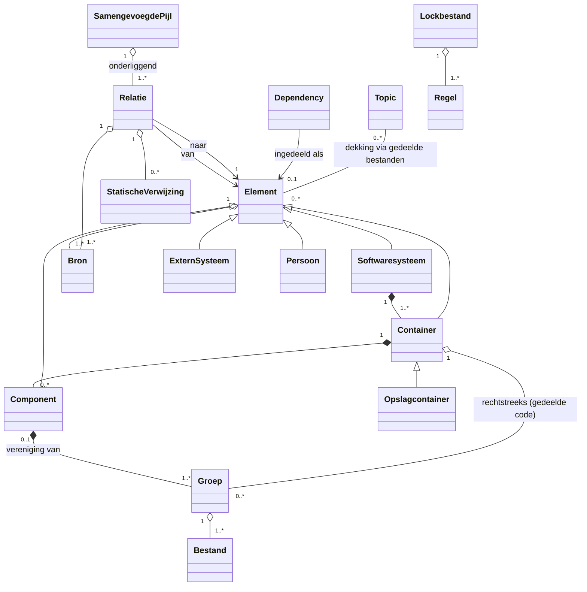
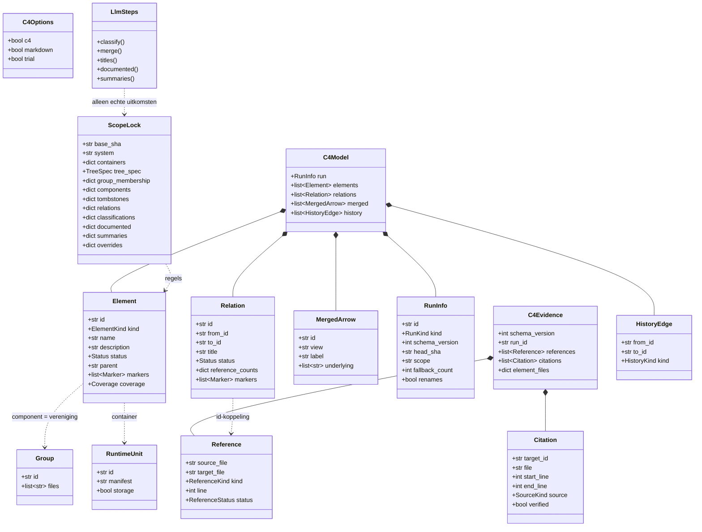

# Model: map-structuuranalyse

Spec: [2026-10-27-map-structuuranalyse-design.md](../specs/2026-10-27-map-structuuranalyse-design.md) · Dossier: geen (zonder dossier, besluitenlog rij 13)

## 1. Domeinmodel

<!-- handgeschreven, zonder dossier -->

Bindend kader: het domeinmodel van de AutoDoc-C4-sessie (`autodoc-c4-design/docs/melly/decisions/2026-10-27-autodoc-c4-map.md`, hierna "C4-log", rij 11–32). Dit hoofdstuk voegt de begrippen en regels toe die `map` nodig heeft om de structuur te leveren. Rijnummers zonder voorvoegsel verwijzen naar `docs/melly/decisions/2026-10-27-map-structuuranalyse.md`.



### Begrippen

| Begrip | Betekenis | Bron |
|---|---|---|
| Softwaresysteem | Precies één per `map`-run; alles binnen root en scope | C4-log rij 31 |
| Container | Deployable met een manifest dat startpunten, binary, siteframework of Dockerfile declareert; bibliotheken horen bij de laadende container | rij 5 |
| Opslagcontainer | Gedeclareerde opslaglocatie (configsleutel, DSN, volume), identiteit = configsleutel | rij 6 |
| Groep | Deterministische bestandsgroep uit `TreeSpec`, herspeelbaar | rij 2, 21 |
| Component | Vereniging van ≥1 groep binnen één container | rij 2 |
| Extern systeem / Persoon | Element buiten het systeem, alleen met ≥1 bron | C4-log rij 21 |
| Dependency | Pakket met ≥1 runtime-import of configuratieverwijzing; ingedeeld als bibliotheek, extern systeem of opslagdriver | rij 9, 12 |
| Statische verwijzing | `(van, naar, soort, regel, status)`; soort import / aanroep / overerving; status telt / alleen type / ongebruikt | rij 7, 11, 32 |
| Relatie | Gericht verband tussen twee elementen, één per geordend paar | rij 1, 35 |
| Samengevoegde pijl | Pijl in een view die onderliggende relaties bundelt | C4-log rij 22, 23 |
| Bron | Code, configuratie of documentatie met bestand:regel | C4-log rij 29 |
| Status | _aangetroffen_ of _gedocumenteerd_ | C4-log rij 29 |
| Topic / Dekking | HyDE-topic; dekking via gedeelde geciteerde bestanden | rij 23; C4-log rij 12 |
| Lockbestand / Regel | Opgeslagen indeling, identiteit, soorten, titels, correcties | rij 18, 26, 31 |
| Run | _volledig_ of _proef_ (`--plan`) | rij 28 |

### Regels met voorbeeld

| # | Regel | Voorbeeld → verwachte uitkomst |
|---|---|---|
| R1 | Een relatie tussen twee _aangetroffen_ interne elementen staat alleen op de kaart met ≥1 statische verwijzing met status _telt_; een citaat zonder zo'n verwijzing is "niet geverifieerd" in het bewijs | `service.py:28` import → pijl Code Mapper → Deep Research (geldig); "Code Mapper voedt AutoDoc" alleen als citaat → niet op de kaart (rij 1) |
| R2 | Een component is een vereniging van hele groepen; elk bestand hoort bij ≤1 component; een groep mag rechtstreeks onder de container blijven, zonder automatische verzamelcomponent | G1+G2 → "Code Mapper"; `render.py` los uit G2 halen → ongeldig (rij 2); `core/types/common.py` rechtstreeks onder de container → geldig, geen "Helpers" (C4-log rij 13; rij 38) |
| R3 | B erft het id van A iff 2·∣A∩B∣ > ∣A∣ en 2·∣A∩B∣ > ∣B∣, over bestanden in beide runs, git-renames gelijk; anders nieuw, nooit hergebruikt id | (a) 8/10 + 2 nieuw → erft; (b) 5 + 5 → beide nieuw; (b′) 6 + 4 → de 6 erft (rij 3, 10) |
| R4 | Id = soort + genormaliseerde letterlijke term; een _gedocumenteerd_ element houdt zijn id als het _aangetroffen_ wordt | "Ontwikkelaar met AI-assistent" (`README.md:60`) → `persoon:ontwikkelaar-met-ai-assistent` (rij 4) |
| R5 | Containers volgen runtime-grenzen; sjablonen tellen niet | `pyproject.toml` → `container:chunkhound`; `chunkhound/autodoc/assets/package.json` (`{{PACKAGE_NAME}}`) → geen container (rij 5) |
| R6 | Een nieuwe dependency krijgt haar soort uit 3 stemmen: 3–0 soort; 2–1 meerderheid + _omstreden_; 1–1–1 bibliotheek + gemarkeerd | `pyarrow` → bibliotheek, _omstreden (1× opslagdriver)_ (rij 12) |
| R7 | Elke statische verwijzing en elk citaat staat onafgekapt in het bewijs | 12 imports + 9 citaten → 21 regels in het bewijs (rij 8) |
| R8 | Type-only en ongebruikte (niet-re-export) imports geven geen pijl | `service.py:30-31` onder `TYPE_CHECKING` → geen pijl; `core/git_diff/__init__.py:1` re-export → telt (rij 7, 11) |
| R9 | Status _aangetroffen_ zodra ≥1 bron code of configuratie is, anders _gedocumenteerd_ | Embedding met `voyageai_provider.py` + `README.md` → _aangetroffen_ (C4-log rij 29) |
| R10 | Een documentatiecitaat telt alleen als het letterlijk op het opgegeven bestand:regel staat | Citaat "Webdashboard" dat niet op `README.md:60` staat → afgekeurd (rij 34) |
| R11 | Handmatige `overrides` in het lockbestand gaan voor op elke afgeleide uitkomst | override `pyarrow = opslagdriver` → geen stemming, soort opslagdriver (rij 31) |
| R12 | Terugval en proef worden nooit opgeslagen | samenvoegstap twee keer time-out → 14 gemarkeerde componenten, lockbestand onveranderd (rij 19, 30) |

Geschiedenis bij R3 (uitvoeringsbesluit R): behoud elk paar met ≥10% overlap aan één kant, over bestanden in beide runs na renames. Meerdere voorgangers → `merge`, anders meerdere opvolgers → `split`, anders `continuation`; het label bewijst geen overerving. Niet-geërfde nieuwe id's krijgen tevens `new` (`from_id=""`), niet-geërfde oude id's `removed` (`to_id=""`) plus tombstone `oud_id → oud_id`. Andere eindpunten zijn echte id's; bestaande tombstones blijven staan en beide kolommen reserveren id's.

### Open issues

- **zonder dossier:** begrippen en regels zijn niet tegen een COGNiam-dossier gecontroleerd (rij 13).

## 2. Ontwerpklassendiagram



`ScopeLock.group_membership` bewaart per container projectrelatieve bestandspaden met `/` → lokale groep-id, ook voor groepen rechtstreeks onder de container. Grouping leest deze vorige membership naast de ongewijzigde CodeBoarding `TreeSpec` en runtime-root; bekende bestanden blijven geplaatst, nieuwe mappen krijgen nieuwe prefix-only regels. De verplichte lockvorm gebruikt schemaversie 2 (gebruikersbesluit taak 7).

## 3. Vertaaltabel

| Begrip / feittype | Ontwerpelement | Soort | Type en omvang | Bestaande tabel/kolom | Opmerking |
|---|---|---|---|---|---|
| Softwaresysteem | `Element` met `kind=system` | class | — | — | één per run |
| Container | `RuntimeUnit` → `Element` met `kind=container` | class | — | — | `runtime.py` |
| Opslagcontainer | `RuntimeUnit.storage` → `Element` met `kind=storage` | attribute | bool | — | |
| Groep | `Group` | class | — | — | uit gekopieerde `clustering/names/` |
| Component | `Element` met `kind=component` | class | — | — | `identity.py` (R3) |
| Extern systeem | `Element` met `kind=external` | class | — | — | |
| Persoon | `Element` met `kind=person` | class | — | — | alleen uit `documented.py` |
| Dependency | lockbestand `classifications` | attribute | — | — | geen eigen element; bibliotheek valt van de kaart |
| Statische verwijzing | `Reference` | class | — | — | `references.py` |
| Relatie | `Relation` | class | — | — | id `<van-id>-><naar-id>` |
| Samengevoegde pijl | `MergedArrow` | class | — | — | `summaries` |
| Bron | `Citation`, `Reference` | class | — | — | |
| Status | `Status` | enum | `found` \| `documented` | — | R9 |
| Topic / Dekking | `Element.coverage` | attribute | — | — | `topic_coverage.py` |
| Lockbestand / Regel | `ScopeLock` | class | — | — | `.chunkhound/map.lock.json` |
| Run | `RunInfo` | class | — | — | `kind` `full` \| `trial`; `id` = sha256 over model en bewijs zonder id, gedeeld met `C4Evidence.run_id` (rij 39) |
| Opgeheven id | `ScopeLock.tombstones` | attribute | — | — | R3 |
| Markering | `Marker` | enum | `fallback`, `trial`, `disputed`, `undescribed`, `imports_only`, `provisional`, `not_merged`, `not_classified` | — | rij 19, 35 |

Omvang van tekstvelden: geen; JSON zonder grens, behalve het samenvattende label (≤60 tekens, rij 35).

## 4. Design patterns

Geen. Er is in deze sessie geen kracht naar voren gekomen die een patroonkeuze vroeg.

## 5. Sequencediagrammen

```mermaid
sequenceDiagram
  participant CLI as commands/code_mapper.py
  participant Topics as HyDE + deep research
  participant C4 as c4-tak
  participant LLM as LlmSteps
  participant Lock as lockfile.py
  participant W as writer (Markdown + c4/writer.py)
  CLI->>Lock: lees sectie scope
  par topics (tenzij --plan)
    CLI->>Topics: HyDE, deep research
  and C4 (tenzij --no-c4)
    CLI->>C4: references, runtime, grouping (replay)
    C4->>LLM: classify / merge / titles (alleen nieuw; niet bij --plan)
  end
  CLI->>LLM: documented (citerende docs bekend; alleen bij gewijzigde hash)
  CLI->>C4: identity, topic_coverage, summaries
  C4->>LLM: summaries (alleen nieuwe labels)
  CLI->>W: Markdown, _c4_model.json + _c4_evidence.json (samen)
  CLI->>Lock: os.replace na volledige run met exitcode 0; terugvalitems weggelaten
```
