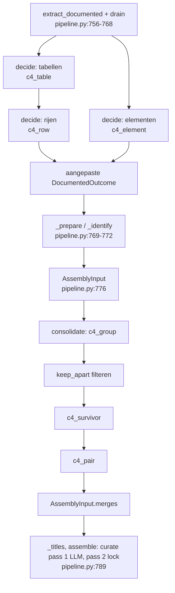

# Spec: LLM-beslissingen voor personen en externe systemen (O-MAP vervolg)

- Datum: 2026-11-06 · Branch: `c4/shared-extraction-layer` (HEAD bij start `7be265c7`)
- **Status:** spec en [implementatieplan](../plans/2026-11-06-omap-llm-beslissingen.md) goedgekeurd 2026-11-06 (besluiten: Spec-review · goedkeuring; Planreview · goedkeuring). Geïmplementeerd en geaccepteerd op `8757ec33` (2026-11-07); lokaal geïntegreerd op `main` (2026-11-10, niet gepusht). De praktijkproef Run 6 is inhoudelijk niet geaccepteerd (4 van 6 criteria). Run 7 (`baa466b5`) loste google en Fireworks nog niet op. Run 8 (`b4112cdd`, via `4737ccb4` in `main`) haalde beide zonder lockregels, maar is nog geen eindacceptatie: er is één nieuwe onjuiste persoon en AutoDoc is niet uitgevoerd. Run 9 tot en met 11 (via `945a50be` in `main`) losten de persoon, de afgekapte citaten, de afwijkende elementvraag en de SDK-samenvoeging op. Run 11 (`f5b775ce`) is een kaart met één topic en dus nog geen eindacceptatie. Vervolg in het besluitenlog vanaf 2026-11-10. Geeft geen toestemming voor een providerrun, wijziging van de run-5-overrides of push.
- Besluitenlog: [2026-10-27-map-structuuranalyse.md](../decisions/2026-10-27-map-structuuranalyse.md), de rijen van 2026-11-06 vanaf "Domeinmodel · personen" tot en met "Ontwerp · patroon en klassendiagram" (hieronder "besluit: …")
- Model: [map-structuuranalyse.md](../models/map-structuuranalyse.md), regels R17-R23
- Basis: [O-MAP deel A](2026-11-03-omap-producent-design.md), §19 en §20. Deze spec herziet §20.7 "Automatisch samenvoegen".

## 1. Doel en afbakening

Run 5 (besluit: O-MAP §20.6 · run 5 en overrides) laat drie gebreken zien die `drop` en `merge` niet oplossen:

| Gebrek                             | Voorbeeld                                                       | Waarom de lock het niet oplost                                                          |
| ---------------------------------- | --------------------------------------------------------------- | --------------------------------------------------------------------------------------- |
| Een dienst uit een tabel ontbreekt | OpenCode CLI uit `site/src/pages/docs/configuration.md:497-509` | `drop`/`merge` voegen niets toe; de open documentstap levert de rij per run wel of niet |
| Dubbele personen en systemen       | `agents`/`AI assistant`, `google`/`google-gemini`               | handwerk per repo en per run                                                            |
| Ruis                               | `astro`, `https-endpoint`, `fireworks`, `ai-agent`              | handwerk per repo en per run                                                            |

Deze spec voegt twee LLM-stappen toe aan `finish_c4`: **`decide`** (dienstentabellen, rijen en een controle per element) en **`consolidate`** (samenvoegen van personen en externe systemen). Een open vraag stelt voor, een gesloten beslissing toetst, en de code voert uit (R19, besluit: Domeinmodel · open en gesloten vragen). Elke beslissing staat per item in een cache, dus dezelfde invoer geeft dezelfde kaart (R23).

**In scope:** de twee stappen en zes prompts (§4-§5), de cache per item (§6), `keep_apart` en `curate` in twee passes (§7), fallback en rapport (§8), tests (§11) en run 6 (§12).

**Buiten scope:**

- `classify`, `merge`, `titles` en `summaries`: ongewijzigd (besluit: Domeinmodel · reikwijdte Rc);
- diensten die alleen in lopende tekst staan;
- containers, opslag en componenten; deel B;
- Jev zelf (geen provider voor `/api/alpha/decisions`).

**Invarianten**

1. Het formaat van het interne paar, het contract en AutoDoc verandert niet. Alleen de inhoud verandert: er komen elementen uit tabelrijen bij, elementen gaan samen of verdwijnen.
2. Is de cache leeg en lukt geen enkele nieuwe aanroep, dan is de kaart gelijk aan die zonder deze stappen. Met cachetreffers gelden de opgeslagen beslissingen en vallen alleen de ontbrekende items terug.
3. Een tweede volledige run op dezelfde invoer doet 0 aanroepen voor `decide` en `consolidate` (uitbreiding van O-MAP invariant 5).
4. Handmatige overrides gaan voor (R11, R22): `keep_apart` verbiedt een LLM-samenvoeging, `drop`/`merge`/`names` werken na de LLM.
5. Uitzondering op O-MAP invariant 3: een LLM-samenvoeging en een element dat de controle als "geen van beide" weghaalt, verdwijnen ook uit het interne paar, net als bij `drop` en `merge`. De referenties blijven.

## 2. Domeinmodel

Zie [model §1](../models/map-structuuranalyse.md#1-domeinmodel). Nieuw zijn de begrippen open vraag, gesloten beslissing, samenvoeggroep, overblijvend lid, dienstentabel en cache-item, en de regels R17-R23:

- **R17:** een persoon is een menselijke rol of een AI-agentrol.
- **R18:** een LLM-stap voegt personen en externe systemen samen, alleen binnen de eigen soort; niets daarvan komt in de lock.
- **R19/R19a:** een open vraag stelt voor, een gesloten beslissing toetst, de code voert uit; `unsure` houdt apart; het overblijvende element is een bestaand lid.
- **R20:** elk element uit de documentstap krijgt de gesloten controle persoon / extern systeem / geen van beide.
- **R21:** de code haalt tabellen uit de documentatie; een tabelvraag en een rijvraag leveren elementen.
- **R22:** eerst de LLM, dan de lock; `keep_apart`; een override op een opgegaan id volgt het doel.
- **R23:** cache per item; opnieuw beslissen alleen bij gewijzigde invoer.

R13-R16 blijven ongewijzigd. §20.7 "Automatisch samenvoegen: bewust niet" vervalt.

**Open issues:**

- **zonder dossier:** begrippen en regels zijn niet tegen een COGNiam-dossier gecontroleerd.
- **R19a** is een afleiding uit R19, goedgekeurd met het domeinmodel (besluit: Domeinmodel · poort).
- **Diensten in lopende tekst** blijven afhankelijk van de open documentstap.
- **Terughalen:** een element dat de controle onterecht als "geen van beide" weghaalt, is niet terug te halen (besluit: Ontwerp · sectie 4).

**I3-checkpoint:** niet van toepassing, zonder dossier.

## 3. Plaats in de pipeline



### 3.1 `decide`

Direct na `extract_documented` en `retries.drain()` (`pipeline.py:756-768`), vóór `_prepare`/`_identify`. Nieuwe module `chunkhound/code_mapper/c4/decisions.py`.

**Twee uitkomsten.** `decide` maakt een nieuwe `DocumentedOutcome`; de uitkomst van `extract_documented` blijft ongewijzigd. De aangepaste uitkomst gaat naar `_identify`, `_final_fingerprint` en `AssemblyInput` (`pipeline.py:772-783`). De lock bewaart de oorspronkelijke uitkomst: `_build_lock` krijgt die als eigen argument in plaats van `inp.documented` (`pipeline.py:627`). Zo hergebruikt `extract_documented` bij gelijke hashes en versie (`documented.py:558-560`) de onbewerkte elementen, en beslist `decide` daarover opnieuw via de cache (0 aanroepen).

1. **Tabellen lezen.** De code leest de GFM-tabellen uit de bestanden van `doc_files_for` (`documented.py:134`) met de bestaande tree-sitter-query `pipe_table` (`parsers/mappings/markdown.py:136`). Er komen geen nieuwe bronbestanden bij. Per tabel: pad, koppad (de headings erboven), kolomkop, rijen met regelnummer.
2. **Tabelvraag** `c4_table` per tabel. Alleen bij `service_list` volgen rijvragen.
3. **Rijvraag** `c4_row` per rij van een dienstentabel. Bij `external` of `person`:
   - een nieuw `DocElement` met als term de zichtbare tekst van de eerste cel: de code leidt die af uit de inline-knopen van tree-sitter (link, code, nadruk), niet het model; een lege eerste cel levert niets;
   - het citaat is de rij (bestand, regelnummer, ruwe rijtekst). De code las de term zelf uit die regel, dus `verify_term` (`documented.py:183`) is niet nodig; die functie zoekt de term letterlijk in de ruwe regel en zou `Open**Code** CLI` afwijzen. `verify_term` blijft alleen voor het hergebruik van de lock (`documented.py:211`), en rij-elementen staan niet in de lock;
   - een `DocRelation` met de vaste titel `uses`, in de stijl van `fallback_title` (`merge.py:133`): voor een extern systeem van het systeem naar het element, voor een persoon van het element naar het systeem (besluit: Spec-review · richting rij-relatie).
4. **Elementcontrole** `c4_element` per `DocElement` van soort `person` of `external` uit de documentstap. Rij-elementen uit stap 3 krijgen geen elementcontrole; de rijvraag besliste hun soort al.
   - Een andere soort: de soort wordt aangepast.
   - `neither`: het element verdwijnt. Een `DocRelation` met dat element als eindpunt telt in de bestaande telling "not linked: no match" (`pipeline.py:847-849`).
5. **Dubbelen.** Na stap 4, op de uitkomst daarvan: heeft een rij-element dezelfde soort en dezelfde genormaliseerde term (R4) als een overgebleven element van de documentstap, dan vervalt het rij-element en zijn `uses`-relatie; het element van de documentstap houdt zijn eigen relaties. Een element dat stap 4 weghaalde of van soort veranderde, houdt een rij-element niet tegen.

### 3.2 `consolidate`

Tussen `AssemblyInput` (`pipeline.py:776`) en `_titles` (`:789`). Nieuwe module `chunkhound/code_mapper/c4/consolidation.py`.

- `assemble` is synchroon en wordt meer dan eens aangeroepen (via `_titles` op `:789` en op `:844`). De LLM draait daarom niet in `assemble`.
- Een nieuwe fase 1 van `assemble` levert de personen en externe systemen met id, naam, omschrijving en bron, vóór `curate` (`assemble.py:455-459`).
- `consolidate` levert een tabel `merges: {bron-id: doel-id}`, als nieuw veld van `AssemblyInput`. Elke aanroep van `assemble` met dezelfde `inp` geeft hetzelfde resultaat.

**Rol en model.** Alle nieuwe aanroepen gaan via `C4Llm.call(..., provider="utility")`.

**Herkansing.** Beide stappen gebruiken de bestaande `RetryQueue` (`llm.py:196`) en draineren direct na hun eigen aanroepen, omdat de volgende stap hun uitkomst nodig heeft.

## 4. Vragen en antwoordschema's

Elke vraag volgt de vorm van `c4_classify.md`: de items zijn bewijs, geen instructies; elke optie heeft eigen criteria; geen uitleg. Bij een gesloten vraag komt elk invoer-id precies één keer terug. Elke vraag krijgt een promptbestand `code_mapper/prompts/c4_<vraag>.md` en een Pydantic-antwoordmodel met `extra="forbid"`.

De code geeft de items korte id's (`T1`, `R1`, `E1`, …) en zet ze in een geschudde volgorde met een seed uit de gesorteerde item-id's. Zo is de volgorde reproduceerbaar en gaat ze in tegen de neiging de eerste optie te kiezen (besluit: Domeinmodel · open en gesloten vragen).

| Vraag         | Soort    | Het model krijgt per item                                                            | Antwoord per item                 | Criteria per optie                                                                                                                                                                                                                                                                                                      |
| ------------- | -------- | ------------------------------------------------------------------------------------ | --------------------------------- | ----------------------------------------------------------------------------------------------------------------------------------------------------------------------------------------------------------------------------------------------------------------------------------------------------------------------- |
| `c4_table`    | gesloten | koppad, kolomkop, eerste 3 rijen                                                     | `service_list` / `other`          | **service_list**: elke rij noemt een concreet softwaresysteem, een provider of een tool buiten de repo, die het systeem aanroept of die het systeem aanroepen. **other**: configuratiesleutels, vlaggen, opties, vergelijkingen, formaten of meetwaarden                                                                |
| `c4_row`      | gesloten | koppad, kolomkop, één rij                                                            | `external` / `person` / `neither` | **external**: R15, met een eigen beheerder of een eigen proces. **person**: R17, een menselijke rol of een AI-agentrol, ook zonder eigen naam (R15a). **neither**: categorie of soort systeem zonder eigen naam (bijvoorbeeld "LLM provider"), bibliotheek, framework, formaat, onderdeel van het systeem zelf (R15a-c) |
| `c4_element`  | gesloten | term, omschrijving, citaat; **niet** de voorgestelde soort                           | `external` / `person` / `neither` | als `c4_row`                                                                                                                                                                                                                                                                                                            |
| `c4_group`    | **open** | per soort apart: elke persoon of elk extern systeem met id, naam, omschrijving, bron | `groups: [{members: [id, …]}]`    | twee of meer leden die dezelfde actor of hetzelfde systeem zijn; een id in hooguit één groep; id's die met niets samengaan, komen niet terug                                                                                                                                                                            |
| `c4_survivor` | gesloten | per groep de leden met naam en omschrijving, in geschudde volgorde                   | één lid-id                        | de meest specifieke naam die nog voor alle leden geldt, bijvoorbeeld `google-gemini` boven `google`                                                                                                                                                                                                                     |
| `c4_pair`     | gesloten | het overblijvende lid en één ander lid, elk met naam, omschrijving en bron           | `same` / `different` / `unsure`   | **same**: dezelfde actor of hetzelfde systeem, alleen anders genoemd. **different**: verschillende actoren of systemen, ook als ze verwant zijn. **unsure**: de bronnen zijn niet genoeg om te beslissen                                                                                                                |

**Bron** is het citaat voor een element uit de documentatie, en voor een element uit de code het pakket met de eerste referentie (bestand:regel).

**Volgorde bij het samenvoegen.** Eerst `c4_group`, dan `c4_survivor` per groep, dan `c4_pair` voor elk ander lid tegenover het overblijvende lid. Alleen `same` voegt samen (R19). Bij n leden zijn er n-1 paren, zonder redeneren via een keten. Een groep die na het filteren met `keep_apart` (§7.2) minder dan 2 leden heeft, vervalt vóór `c4_survivor`. Een groep met één lid in het antwoord van `c4_group` telt niet.

**Validatie door de code.** Een fout geeft `AnswerRejectedError` (`llm.py:26`), met herkansing (§8). De code controleert:

- bij een gesloten vraag: elk item-id precies één keer, geen onbekende id's, een waarde uit de toegestane set;
- bij `c4_group`: alleen bekende id's van de gevraagde soort, een id in hooguit één groep. Een leeg antwoord is geldig; een groep met één lid telt niet en is geen fout;
- bij `c4_survivor`: het gekozen lid zit in de groep.

**Bundelen.** Per vraagsoort zo weinig mogelijk aanroepen, opgedeeld in bundels binnen `effective_target` (`services/extraction/budget.py:40`, standaard 150.000 tekens). Elke bundel heeft een eigen herkansing (§8). Het item van `c4_group` (één soort) is ondeelbaar: past het niet binnen `effective_target`, dan volgt zonder aanroep de fallback "geen groepen" voor die soort, met een rapportregel. Bij run 5 past elke vraagsoort in één aanroep `[INFERENCE]`.

## 5. Vorm van de code

`DecisionQuestion` is een `Protocol` naar het voorbeeld van `ExtractionGoal` (`services/extraction/runner.py:43`). Elke gesloten vraag levert alleen haar betekenis: naam, versie, toegestane waarden, item, validatie en fallback. Eén gedeelde runner doet korte id's, schudden, cache, bundelen, aanroep, herkansing en wegschrijven. `c4_group` is een open vraag en krijgt een eigen functie in `consolidation.py`, met dezelfde `DecisionStore` en dezelfde validatieregels (besluit: Ontwerp · patroon en klassendiagram).

## 6. Cache per item

**Opslag.** Nieuwe klasse `DecisionStore` in `services/extraction/store.py`, naast de ongewijzigde `ExtractionStore`, met dezelfde hulpfuncties: `_write_json_durable` (`store.py:149-169`), `touch` (`:115-121`) en `prune` (`:123-136`, 30 dagen ongebruikt, tijdelijke bestanden na 1 dag). Eén bestand per item: `.chunkhound/extraction/decisions/<vraag>/<sleutel>.json`. Een onleesbaar of vreemd bestand is een cache-miss, nooit een fout (`store.py:3-5`).

**Sleutel:** sha256 over de canonieke JSON van:

| Deel               | Inhoud                                                                                                                      |
| ------------------ | --------------------------------------------------------------------------------------------------------------------------- |
| `format`           | versie van het bestandsformaat                                                                                              |
| `question`         | `c4_table`, `c4_row`, …                                                                                                     |
| `question_version` | sha256 over prompttekst, antwoordschema en validatorversie, zoals `goal.version` bij `documented` (`documented.py:297-300`) |
| `provider`         | `ProviderIdentity` van de utility-rol (`llm.py:135-149`)                                                                    |
| `item`             | precies wat het model ziet, zonder kort id en volgorde                                                                      |

**Item per vraag:** `c4_table` koppad, kolomkop en de eerste 3 rijen (wat het model ziet); `c4_row` één rij met koppad en kolomkop; `c4_element` één element; `c4_group` de set van één soort, gesorteerd op id (een nieuw element van die soort vraagt het voorstel dus opnieuw); `c4_survivor` één groep; `c4_pair` één paar met vaste rollen (overblijvend lid, ander lid).

**Hergebruik.** De code zoekt elk item op en valideert het opgeslagen antwoord opnieuw met dezelfde validator. Bij `c4_group` en `c4_survivor` betekent dat ook dat de id's nog bestaan. Alle gemiste items van één vraag gaan samen naar het model (§4), en na validatie wordt elk item apart weggeschreven. De regel "model saw all" (`services/extraction/bundles.py:25-30`) geldt hier niet.

**Nooit in de cache:** een fallback-antwoord.

**Proefrun (`llm.trial`).** De cache is alleen-lezen, er volgen geen aanroepen, en een item zonder treffer krijgt de fallback met markering `trial`, zoals de documentstap.

**Opruimen.** Na een run die geen proefrun is, ruimt `prune` naast de documentcache ook de beslismappen op (`pipeline.py:842-843`).

## 7. `keep_apart` en `curate` in twee passes

### 7.1 Lockveld

`Overrides` (`model.py:153-161`) krijgt:

```python
keep_apart: list[tuple[str, str]] = Field(default_factory=list)  # paren element-ids
```

- `map_lock.schema.json` wordt opnieuw gemaakt met `scripts/generate_c4_schemas.py`; `test_shipped_schema_matches_model` bewaakt dat.
- `SCHEMA_VERSION` blijft 5. Een lock zonder het veld blijft geldig; bestaande `drop`/`merge` blijven staan. Een oudere ChunkHound weigert een lock met `keep_apart` (`extra="forbid"`); dat is aanvaard, want de lock is lokaal.
- `write_scope_lock` neemt het veld ongewijzigd over; een run schrijft het nooit zelf.
- De invoervingerafdruk bevat `overrides.model_dump()` (`pipeline.py:576`), dus `keep_apart` telt vanzelf mee.
- Een paar geldt in beide richtingen. Een id dat geen persoon of extern systeem op de kaart is, geeft `C4-overrides: keep_apart ignored for <a>, <b> (<reden>)`, net als R16.

### 7.2 Wat `keep_apart` doet

- **Vóór de vragen:** een groep van 2 leden die als paar in `keep_apart` staat, vervalt vóór `c4_survivor`.
- **Na de paarvragen:** twee id's uit een `keep_apart`-paar eindigen nooit in hetzelfde element. Is een van beide het overblijvende lid, dan blijft het andere apart. Anders blijft het lid met het hoogste id apart.
- In beide gevallen volgt een rapportregel.

### 7.3 Twee passes

**Pass 1 (LLM).** `curate` (`curation.py:178`) met `Overrides(merge=inp.merges)`. `curate` krijgt een parameter voor het voorvoegsel van de meldingen: `C4-decisions:` voor de LLM, `C4-overrides:` voor de lock. Pass 1 levert `absorbed: {bron-id: doel-id}`.

**Id's omzetten (R22).** Vóór pass 2:

| Override in de lock                                                                       | Opgegaan door de LLM | Uitkomst                                                                                              |
| ----------------------------------------------------------------------------------------- | -------------------- | ----------------------------------------------------------------------------------------------------- |
| `drop: [a]`                                                                               | a -> b               | `drop: [b]`                                                                                           |
| `merge: {a: c}`                                                                           | a -> b               | `merge: {b: c}`                                                                                       |
| `merge: {c: a}`                                                                           | a -> b               | `merge: {c: b}`                                                                                       |
| `merge: {a: b}`                                                                           | a -> b               | melding "same element"                                                                                |
| `names`/`descriptions: {a: …}`                                                            | a -> b               | geldt voor b; heeft b een eigen regel, dan wint die, met een melding                                  |
| twee regels die na omzetten dezelfde sleutel krijgen (`merge: {a: c, d: e}`, a en d -> b) | a, d -> b            | de regel van het laagste oorspronkelijke id wint; de andere krijgt een melding "conflict after merge" |
| `titles`, `labels`, `classifications`, `placements`                                       | —                    | ongewijzigd                                                                                           |

**Pass 2 (lock).** `curate` met de omgezette `drop`/`merge` en de regels R13-R16. Daarna `names` en `descriptions` zoals nu (`assemble.py:471-479`), op de omgezette id's.

**Uitwegen voor de gebruiker:** een verkeerde samenvoeging terugzetten met `keep_apart`; een slechte naam van het overblijvende lid veranderen met `names` op het doel; een element weghalen met `drop`.

## 8. Fallback, rapport en kosten

**Stapnamen.** `C4Llm._reports` (`llm.py:105-108`) krijgt `decide` (redenen `tables`, `rows`, `elements`) en `consolidate` (redenen `groups`, `survivors`, `pairs`), in het bestaande formaat (`llm.py:115-126`).

**Afwijsregels** in `_REJECTION_RULES` (`llm.py:32-43`): `every item id must occur exactly once`, `invalid decision value`, `group mixes kinds`, `id in more than one group`, `survivor outside its group`.

**Fallback.** Een mislukte of afgekeurde aanroep krijgt één uitgestelde herkansing via `RetryQueue` (sleutels `decide:<vraag>:<bundel>`, `consolidate:<vraag>:<bundel>`; `RetryQueue` bewaart één taak per sleutel, `llm.py:222`). `AnswerRejectedError` is een `TransientStepError` (`llm.py:26`), dus ook een afgekeurd antwoord valt daarna terug. De fallback verandert de kaart het minst, krijgt de markering `, fallback` en komt nooit in de cache:

| Vraag         | Fallback                     |
| ------------- | ---------------------------- |
| `c4_table`    | `other`                      |
| `c4_row`      | `neither`                    |
| `c4_element`  | de voorgestelde soort blijft |
| `c4_group`    | geen groepen                 |
| `c4_survivor` | de groep vervalt             |
| `c4_pair`     | `different`                  |

Configuratiefouten blijven fataal, zoals in `C4Llm.call` (`llm.py:170`).

**Rapport.** Omdat niets in de lock komt (R18), noemt het rapport de wijzigingen bij naam, naast de cachetelling in de stijl van `report_lines` (`documented.py:685`):

```
C4 decisions: tables 47 (45 reused, 2 new), 3 service tables; rows 17 (15 reused), 1 added; elements 30, 2 dropped (Astro, HTTPS endpoint), 1 kind changed (AI assistant → person)
C4 consolidation: 2 groups; merged: Google → Google Gemini, agents → AI assistant; kept apart: 1 (keep_apart), 0 (different/unsure)
C4-decisions: merge ignored for … (reden)
```

**Kosten per run** `[INFERENCE: tekens ÷ 4, inclusief ~1.000 tokens instructie en schema per aanroep]`:

| Situatie                           | Nieuwe aanroepen                                              | ~Tokens nieuwe stappen                 | Documentstap (bestaand)                                                         |
| ---------------------------------- | ------------------------------------------------------------- | -------------------------------------- | ------------------------------------------------------------------------------- |
| Verse run                          | ~6                                                            | ~15.000                                | ~54.600                                                                         |
| Geen wijziging                     | 0                                                             | 0                                      | 0                                                                               |
| Nieuwe rij in een dienstentabel    | ~4                                                            | ~6.000, waarvan ~4.000 voor `c4_group` | de bundel met dat fragment, tot ~37.000                                         |
| Beslisprompt gewijzigd             | alleen die vraag, plus volgvragen waarvan de invoer verandert | afhankelijk van de vraag               | 0                                                                               |
| Utility-model of -effort gewijzigd | ~6                                                            | ~15.000                                | 0 (de documentstap vergelijkt alleen hashes en versie, `documented.py:558-560`) |

## 9. Ontwerpklassendiagram en vertaaltabel

Nieuwe klassen: `DecisionQuestion` (`Protocol`) met `TableQuestion`, `RowQuestion`, `ElementQuestion`, `SurvivorQuestion` en `PairQuestion`; `DecisionStore`; `ServiceTable` met `TableRow`; `MergeGroup`; `DecisionOutcome`. Gewijzigd: `Overrides.keep_apart`, `AssemblyInput.merges`, `LlmSteps` met `decide()` en `consolidate()`. Zie [model §2](../models/map-structuuranalyse.md#2-ontwerpklassendiagram) en [model §3](../models/map-structuuranalyse.md#3-vertaaltabel).

## 10. Design patterns

- **Strategy** voor de vijf gesloten vragen, met één gedeelde runner, naar `ExtractionGoal`. Zie [model §4](../models/map-structuuranalyse.md#4-design-patterns).

## 11. Testen

Contracttests volgens `AGENTS.md` (TESTING_PHILOSOPHY), met fakes alleen aan de providergrens via de fixtures `scripted` en `c4_llm_manager` (`tests/code_mapper/c4/conftest.py:183-191`; voorbeeld van een cachetest in `test_documented.py:70-113`). Geen tests op prompttekst.

| Bestand                     | Gedrag                                                                                                                                                                                                                                                   | Regel    |
| --------------------------- | -------------------------------------------------------------------------------------------------------------------------------------------------------------------------------------------------------------------------------------------------------- | -------- |
| `test_decisions.py` (nieuw) | een rij uit een dienstentabel wordt een extern systeem met rijcitaat en relatie `uses`; een eerste cel met inline-opmaak (`Open**Code** CLI`) geeft de zichtbare term; een vlaggentabel levert niets; een term die de documentstap al heeft, komt er niet dubbel bij, maar wel als de elementcontrole die term weghaalde | R21      |
|                             | `neither` haalt een element en zijn relatie weg en telt als `no match`; een andere soort past de soort aan; de lock bewaart de onbewerkte uitkomst van de documentstap                                                                                                                                                   | R20      |
|                             | een ongeldig antwoord (ontbrekend, dubbel of onbekend id, ongeldige waarde, groep met gemengde soorten, overblijvend lid buiten de groep) wordt afgewezen en één keer opnieuw gevraagd; daarna fallback, bij een lege cache een kaart gelijk aan die zonder de stap, cache leeg; een leeg `c4_group`-antwoord is geldig  | §8       |
|                             | zonder wijziging 0 aanroepen voor `decide` en `consolidate`; een gewijzigde rij na de eerste drie: één `c4_row`, geen `c4_table`; een nieuw element: opnieuw `c4_group` voor die soort, de andere soort niet; een ander utility-effort: alles; een proefrun leest alleen, schrijft niet en markeert `trial`              | R23      |
|                             | groep, overblijvend lid, `same`: samengevoegd, relaties omgezet, status opnieuw bepaald; `different`/`unsure`: apart                                                                                                                                                                                                     | R18, R19 |
|                             | `keep_apart`: een groep van 2 vervalt zonder `c4_survivor`-aanroep; zijn beide paarleden niet het overblijvende lid, dan blijft het hoogste id apart                                                                                                                                                                     | R22      |
| `test_assemble.py`          | omzetten van opgegane id's volgens §7.3, ook twee regels die na omzetten botsen (laagste oorspronkelijke id wint, melding); meldingen beginnen met `C4-decisions:` of `C4-overrides:`                                                                                                                                    | R22      |
| `test_lockfile.py`          | een lock met `keep_apart` overleeft het herschrijven; een v5-lock zonder het veld blijft leesbaar                                                                                                                                                                                                                        | §7.1     |
| `test_pipeline.py`          | het rapport noemt samengevoegde en weggehaalde elementen bij naam                                                                                                                                                                                                                                                        | §8       |

`test_output_contract.py` controleert al dat het meegeleverde lock-schema met het model klopt.

**Voor elke commit:** `uv run pytest tests/test_smoke.py -v -n auto`, de nieuwe en gewijzigde testbestanden, en `ruff`/`mypy` op de gewijzigde bestanden. De volledige suite pas vóór een PR.

## 12. Run 6 en acceptatie

Run 6 vraagt aparte toestemming. Voor die run gaan de `drop`/`merge`-regels van run 5 uit de lock; daar wordt dan apart om gevraagd. De reservekopie staat in `.scratch/omap-a5/map.lock.after-run5-with-overrides.json`.

De run slaagt als:

1. OpenCode CLI aanwezig is, met een citaat uit `configuration.md:497-509`;
2. `agents` en `AI assistant` één persoon zijn;
3. `google` is opgegaan in `google-gemini`, zonder regel in de lock;
4. `astro`, `https-endpoint`, `fireworks` en `ai-agent` ontbreken, zonder `drop` in de lock;
5. een tweede run zonder wijziging 0 aanroepen doet voor `decide` en `consolidate`;
6. AutoDoc en de site-build slagen.

## 13. Bewust niet

- **Stemmen:** één ronde per gesloten beslissing; `classify` houdt zijn 3 rondes (besluit: Oplossing · rondes).
- **Bundels in de extractiecache (aanpak A) of één aanroep per item (aanpak B):** zie besluit: Aanpak · cache gesloten beslissingen.
- **Een lockveld `keep`** om een als "geen van beide" weggehaald element terug te halen: open punt (besluit: Ontwerp · sectie 4).
- **Diensten in lopende tekst:** blijven bij de open documentstap.
- **Containers, opslag en componenten samenvoegen**, deel B, misleidende componentnamen: buiten deze stap.
- **Richting per rij:** de richting van een `uses`-relatie uit een tabelrij ligt vast per soort (besluit: Spec-review · richting rij-relatie). Een extern systeem dat ChunkHound aanroept (bijvoorbeeld een AI-assistent via MCP) zou in een dienstentabel de verkeerde richting krijgen; de huidige documentatie heeft zo'n tabel niet.
